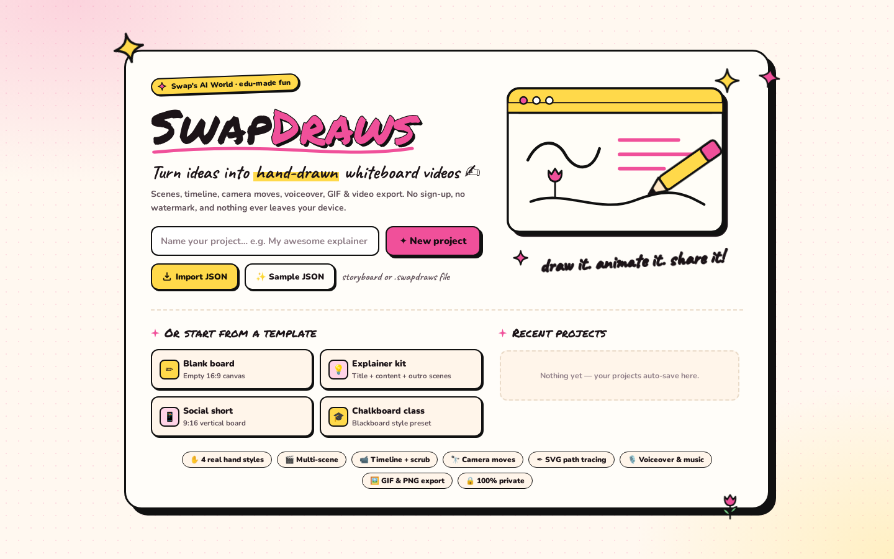
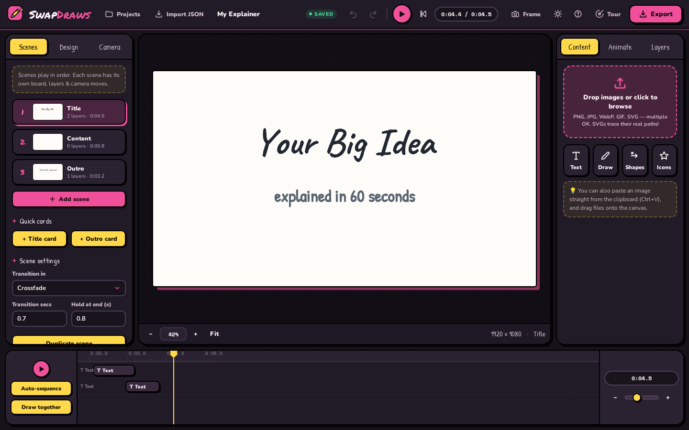

<div align="center">

# ✍️ SwapDraws

### Turn ideas into hand-drawn whiteboard videos

*A free, in-browser whiteboard animation studio · edu-made fun* 🌷✨

[](https://swap-draws.vercel.app/)
[](LICENSE)
[](#-quick-start)
[](#-privacy)
[](#-architecture)

**[✨ Try it live →](https://swap-draws.vercel.app/)**

No sign-up · no watermark · no uploads. Everything runs **100% locally** in your browser.



</div>

---

## 📚 Contents

- [🚀 Quick start](#-quick-start)
- [🎨 Features at a glance](#-features-at-a-glance)
- [✨ Feature tour](#-feature-tour)
- [🤖 Let an AI write your storyboard](#-let-an-ai-write-your-storyboard)
- [📥 JSON storyboards](#-json-storyboards--write-your-video-as-a-file)
- [🏗 Architecture](#-architecture)
- [🙏 Attribution & licenses](LICENSE)
- [🔒 Privacy](#-privacy)

---

## 🚀 Quick start

**Just want to make a video?** Open **[swap-draws.vercel.app](https://swap-draws.vercel.app/)**. That's it.

**Running it yourself?** SwapDraws is a fully static web app: no build step, no dependencies, no server-side code.

```bash
# any static file server works:
git clone https://github.com/swapagrawal14/swap-draws.git
cd swap-draws
python3 -m http.server 8000
# → open http://localhost:8000
```

> 💡 Opening `index.html` via `file://` mostly works too, but a local server is recommended because browsers restrict IndexedDB/fonts on `file://` URLs.

---

## 🎨 Features at a glance

<table>
<tr>
<td width="33%" valign="top">

### ✋ Real hand drawing
A hand actually **traces** your text, shapes, icons and SVG paths, and even *writes* your words stroke by stroke.

</td>
<td width="33%" valign="top">

### 🎬 Multi-scene stories
Scenes, 8 transitions, title & outro cards, and 4 ready-made templates.

</td>
<td width="33%" valign="top">

### 🖼️ Any content
Text in 9 fonts, ~30 smart shapes, 55+ icons, SVG import, photos sketched by edge detection, plus freehand drawing.

</td>
</tr>
<tr>
<td valign="top">

### 🌀 16 reveal styles
Outline, chalk, sketch, handwrite, typewriter, scanner, spiral, pop and more. Each layer gets its own ink, wobble and hand.

</td>
<td valign="top">

### 📹 Virtual camera
Keyframed pans & zooms with easing, or one-click **auto-focus**.

</td>
<td valign="top">

### ⏱️ Real timeline
Drag, stretch and overlap layer bars; scrub to any exact frame.

</td>
</tr>
<tr>
<td valign="top">

### 🎙️ Sound
Mic voiceover, background music, pencil-scratch SFX, or pre-recorded audio inside a JSON script.

</td>
<td valign="top">

### 📤 Export
WebM / MP4 up to 60 fps, looping GIF, PNG stills. **No watermark, ever.**

</td>
<td valign="top">

### 🔒 Private by design
Auto-saves to your browser. Nothing is ever uploaded.

</td>
</tr>
</table>

<div align="center">

<br><sub>The studio (dark theme): scenes on the left, the board in the middle, content &amp; animation tools on the right, timeline below.</sub>
</div>

---

## ✨ Feature tour

### 🎬 Scenes & story flow
- **Multi-scene projects**: add, duplicate, reorder and delete scenes; per-scene background, transition and hold time
- **8 scene transitions**: fade, erase, wipe, slides, zoom…
- **Title & outro cards**: one click adds a styled title or "thanks for watching" scene
- **4 ready templates**: Blank, Explainer, Social Short (9:16), Chalkboard Class

### 🖼️ Canvas & backgrounds
- 16:9 · 9:16 (vertical shorts) · 1:1 · 4:3 aspects, at 720p / 1080p / 4K
- 10 hand-crafted backgrounds: white paper, dots, grid, kraft, blueprint, two chalkboards, dark board, warm paper, graph paper, with subtle chalk speckle & smudge textures
- Per-scene background override

### 🧩 Content layers
- **Text**: 9 embedded hand-lettered & sans fonts (Caveat, Patrick Hand, Permanent Marker, Shadows Into Light, Kalam, Nunito, DM Sans, Merriweather, Space Mono), size, color, alignment, line-height, letter-spacing, bold/italic, **underline / squiggle / highlight accents** drawn live by the hand at the end
- **Shapes**: ~30 smart shapes (arrows, banners, stars, speech bubbles, cycles, pyramids…) that the hand *actually traces* as a pen would
- **Icon library**: 55+ built-in icons, colored and stroked however you like
- **SVG import**: drop in any SVG; its *real vector paths* are traced by the pen in document order, preserving stroke colors & widths
- **Image import**: photos & art are edge-detected (4 detectors: Sobel, adaptive threshold, chroma, LoG) and sketched, then the color **reveals** underneath the drawing
- **Freehand drawing**: pen, marker, highlighter & stroke eraser tools right on the stage; your strokes replay as part of the animation
- Move / resize / rotate layers with snapping guides, grid, multi-select, copy-paste, z-order, lock, hide, flip, opacity, keyboard nudging

### 🌀 Animation engine
- **16 reveal styles**: Outline draw · Draw + color fill · Chalk · Sketch · **Handwrite** (skeletonised text: the pen genuinely *writes* your words) · Typewriter · Scanner · Chunks · Spiral · Radial · Wipe · Fade · Pop · Slide · Rise · Instant
- **5 exit styles** when a scene wraps up
- Direction control (left-to-right, radial, random…), speed, per-layer pen color & width, jitter, color-fill reveal toggle, rainbow pen
- **Hand overlay**: 4 hand styles × portrait & landscape variants, with pen-angle rotation, subtle tremor and automatic lift between layers
- **Virtual camera**: keyframed pan & zoom with easing, auto-focus on active layers, live preview
- Everything is a **pure function of time**: frame-perfect scrubbing, deterministic exports

### ⏱️ Timeline
- Drag layer bars to re-time, stretch to change duration, snap-to grid
- Camera keyframe lane: drag diamonds, double-click to edit, right-click to delete
- Auto-sequence & "draw together" helpers

### 📤 Export
- **WebM & MP4 video**: any fps up to 60, scale up to 2×, quality presets, with an EBML duration patch so exported files report the correct length everywhere
- **Animated GIF**: custom in-browser GIF89a encoder (6-6-6 web palette + Floyd–Steinberg dithering + LZW)
- **PNG snapshot** of any moment
- **Audio!** Record a **voiceover from your mic** while the animation plays, mix in a **music file** (loopable), plus automatic **pencil-scratch sound effects** while the hand draws, or ship **pre-recorded clips & a full voiceover track** inside a JSON storyboard (see below)

### 💖 Quality of life
- **Dark & light themes** (one toggle, persisted)
- Guided first-run **tour** + searchable shortcut help (`?`)
- Full keyboard shortcut set (Space, Ctrl+Z/Y, Ctrl+D, Ctrl+drag-copy, Delete, arrows, `+`/`-` zoom…)
- **Auto-save** to IndexedDB/localStorage on every action + crash-proof 30 s backups, multi-project manager, `.swapdraws` JSON export/import (assets embedded) for moving projects between machines
- Small-screen notice on phones (the studio wants a desktop)

---

## 🤖 Let an AI write your storyboard

Don't want to write JSON by hand? **[`AI-STORYBOARD-PROMPT.md`](AI-STORYBOARD-PROMPT.md)** is a ready-made system prompt that turns any AI chat or agent (ChatGPT, Claude, Gemini, Grok, Qwen, Kimi, coding agents…) into a **SwapDraws Director**.

1. Copy the prompt from the code block in [`AI-STORYBOARD-PROMPT.md`](AI-STORYBOARD-PROMPT.md) and paste it as the system prompt (or first message).
2. Describe your video. The AI asks about duration, aspect ratio, art style and voiceover, then plans the scenes.
3. It hands you a ready-to-import **SwapDraws Script JSON** (it can even embed pre-recorded narration).
4. Drop that file onto SwapDraws and press play. 🎉

---

## 📥 JSON storyboards: write your video as a file

Prefer code to clicks? SwapDraws imports **JSON storyboards**: hand-authored (or AI-generated) scene descriptions that build a complete animation automatically.

**Where:** the **Import JSON** button in the top bar, the welcome screen, the Projects modal, or just drag a `.json` / `.swapdraws` file onto the window. Hit **✨ Sample JSON** on the welcome screen to download a working example, or export any project as an editable script via *Projects → ⬇ as script JSON*.

```json
{
  "swapdraws": 1,
  "name": "My JSON Video",
  "canvas": { "aspect": "16:9", "resolution": 1080 },
  "scenes": [
    {
      "name": "Intro",
      "background": "dots",
      "hand": "hand1",
      "transition": { "type": "wipe-left", "duration": 0.7 },
      "hold": 0.8,
      "camera": { "enabled": true, "keys": [ { "t": 0, "x": 0.5, "y": 0.5, "zoom": 1.4 }, { "t": 3, "x": 0.5, "y": 0.5, "zoom": 1 } ] },
      "layers": [
        { "type": "text", "text": "Made from pure JSON ✨", "font": "Caveat", "size": 0.15,
          "y": 0.4, "style": "handwrite", "underline": "squiggle", "duration": 2.5 },
        { "type": "icon", "icon": "rocket", "color": "#e85d3d", "x": 0.82, "y": 0.32, "size": 0.13 }
      ]
    }
  ]
}
```

### 📏 Conventions
- Coordinates (`x`, `y`) and sizes: **fractions of the canvas** (`0.5` = middle; the layer centers on the point) or **pixels** (values > 1). Text `size` ≤ 1 = fraction of canvas height. Keywords `center/left/right/top/bottom` allowed for `x`/`y`.
- Layers **auto-sequence** in order (0.25 s gap) unless you give them `delay`/`start`. `duration: "auto"` is the default, estimated from path length.
- Unknown ids fall back gracefully and are listed as warnings in the console/toast. Nothing hard-fails unless the file is unusable.

### 🧱 Layer reference

<details>
<summary><b>Click to expand the full layer, scene &amp; property reference</b></summary>

<br>

| type | key fields |
|---|---|
| `text` | `text`, `font` (9 embedded families), `size`, `color`, `bold`, `italic`, `align`, `lineH`, `spacing`, `underline` (`none`/`line`/`squiggle`/`highlight`) |
| `icon` | `icon` (any library id, kebab-case ok), `color`, `sw`, `size` |
| `shape` | `shape` (any library id, kebab-case ok), `color`, `fill`, `strokeWidth` |
| `svg` | `src`: `data:image/svg+xml,…` or a URL; real paths are traced |
| `image` | `src`: `data:` URL or image URL; sketch + color reveal |
| `drawing` | `strokes: [{pts:[x,y,…], color, width, alpha}]` in canvas px (or `normalized: true` for 0..1) |
| `audio` | `src`: a **data-URL** (mp3/wav/ogg/m4a) or URL; `delay`, `duration` (default = clip length), `volume` (0–1), `loop`. Invisible on canvas; shows as a **🔊 timeline bar** (drag/resize it to re-time & trim). Doesn't shift the visual layer chain: without `delay` it starts with the scene |

**Any layer** also accepts: `name`, `w`, `h`, `rot`, `opacity`, `flipX`, `flipY`, `hidden`, `delay`, `duration`, `style` (16 animation styles), `dir`, `easing`, `ink`, `strokeWidth`, `fillReveal`, `rainbow`, `jitter`, `sfx`, `hand` (`hand1…4`/`none`), `handRotate`, `algo`, `sensitivity`, `exit: {style, duration}`.

**Any scene** accepts: `name`, `background` (`white`/`black`/`chalk`/`blueprint`/`kraft`/`neon`/`grid`/`dots`/`ruled` or `{type, color}`), `hand` (scene default), `transition` (`fade`/`erase`/`zoom`/`wipe-*`/`slide-*`/`none`), `hold`, `camera.keys` (pan/zoom keyframes) or `autoCamera: true`.

</details>

### 🔊 Sound in scripts
- Top-level **`"voiceover"`**: one full-track audio for the whole video: `"voiceover": "data:audio/…"` or `{ "src": "data:audio/…", "volume": 0.9, "start": 0, "name": "Narration" }`.
- **`audio` layers** are per-scene clips placed on the timeline.
- Both **play live during in-app playback** (auto pause/seek synced to the playhead) and are **mixed into WebM/MP4 exports**, decoded and scheduled sample-accurately on the WebAudio clock alongside the mic/music options, which still work as before.
- Audio blobs persist in the app's asset store, and **project backups** (`.swapdraws.json`) embed them, so audio round-trips everywhere.

`.swapdraws` project backups (from *Projects → ⬇ Download current as file*) import through the same button; the importer auto-detects which flavor it got.

---

## 🏗 Architecture

Plain ES2020 modules on a shared `window.SD` namespace. No bundler, no runtime deps.

```
swapdraws/
├── index.html          app shell (top bar, panels, stage, timeline, modals)
├── css/style.css       dark + light themes, all components
├── js/
│   ├── util.js         uid, math, easing, event bus, DOM helpers, toasts
│   ├── assets.js       hand images, IndexedDB blob store, embedded fonts
│   ├── ink.js          edge detectors, thickness filter, Zhang–Suen skeletoniser,
│   │                   greedy polyline tracer, natural pen-flow sequencer, dab orders
│   ├── engine.js       deterministic pure-time renderer: plans, styles, camera,
│   │                   hands, backgrounds, transitions (the heart of the app)
│   ├── state.js        project model, undo/redo, persistence, templates
│   ├── tools.js        shape/icon/SVG path sampling, freehand strokes
│   ├── stage.js        zoom/pan canvas, selection & transforms, drawing mode
│   ├── timeline.js     scrubber, layer bars, camera lane
│   ├── panels.js       left/right panels, pickers, style presets
│   ├── export.js       WebM/MP4 recorder (+EBML duration patch), GIF encoder, audio mixer
│   ├── tour.js         welcome screen + guided tour + help modal
│   └── main.js         boot, theme, shortcuts, project manager
└── assets/
    ├── hands/          hand PNGs (1080p ×4 horizontal, ×3 vertical)
    └── fonts/          woff2 files + fonts.css (all OFL licensed)
```

### 🧠 Key ideas

- **Plans**: every layer compiles to a render plan (traced strokes, dab masks, fill regions) cached by content-hash. Rendering is a pure function `frame = f(project, t)` — so scrubbing, export and live preview can never disagree.
- **Handwriting**: text glyphs are rasterised, reduced to 1-pixel **centerline skeletons** (Zhang–Suen thinning), traced, sequenced by a nearest-neighbour walk with stroke-reversal and a left-to-right bias, and stroked at the *measured* glyph thickness — the result really looks like someone writing.
- **Images**: multi-scale edge detection (Sobel + NMS + hysteresis, adaptive integral-image threshold, chroma, LoG) with a thickness filter; the sketch phase is then filled by a dab-masked color reveal following the pen.

---

## 🙏 Attribution & licenses

- Hand photographs & the original concept: **[Inkplainer](https://inkplainer.pages.dev/)** by NadirWeb-App, Apache License 2.0 (see `assets/hands/LICENSE-inkplainer-assets`). SwapDraws is an independent, heavily extended re-implementation.
- All fonts are licensed under the **SIL Open Font License 1.1**: Caveat, Patrick Hand, Permanent Marker, Shadows Into Light Two, Kalam, Nunito, DM Sans, Merriweather, Space Mono (Google Fonts).
- Everything else: MIT licensed, see [`LICENSE`](LICENSE). Have fun, make great videos!

## 🔒 Privacy

SwapDraws never sends your work anywhere. Projects, images and recordings live in your browser's local storage only. Clear your browser data and they're gone, so export a `.swapdraws` file when you want a backup.

---

<div align="center">

🌷 **Made by [Swapnil Agrawal](https://github.com/swapagrawal14) · Swap's AI World** ✨

<sub>edu-made fun · draw it. animate it. share it!</sub>

</div>
