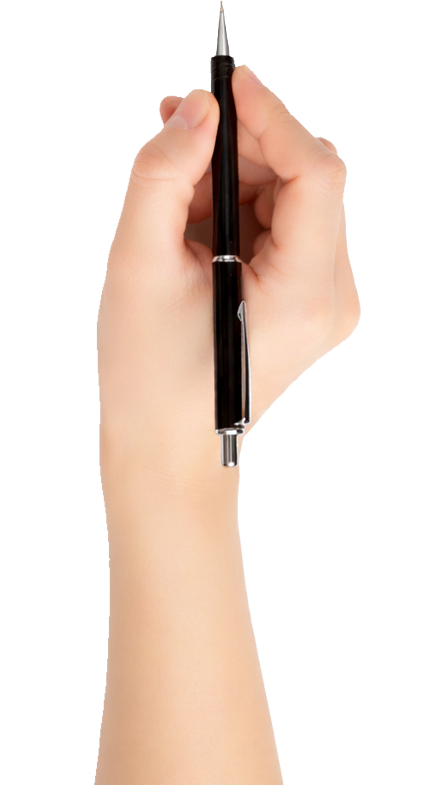

# ✍️ SwapDraws — Whiteboard Animation Studio

Create hand-drawn **whiteboard explainer animations** right in your browser.
No sign-up, no watermark, no uploads — everything runs **100% locally** on your machine.



---

## 🚀 Quick start

SwapDraws is a fully static web app — no build step, no dependencies, no server-side code.

```bash
# any static file server works:
cd swapdraws
python3 -m http.server 8000
# → open http://localhost:8000
```

(Opening `index.html` via `file://` mostly works too, but a local server is recommended because browsers restrict IndexedDB/fonts on `file://` URLs.)

---

## ✨ Feature tour

### Scenes & story flow
- **Multi-scene projects** — add, duplicate, reorder and delete scenes; per-scene background, transition and hold time
- **8 scene transitions** — fade, erase, wipe, slides, zoom…
- **Title & outro cards** — one click adds a styled title or "thanks for watching" scene
- **4 ready templates** — Blank, Explainer, Social Short (9:16), Chalkboard Class

### Canvas & backgrounds
- 16:9 · 9:16 (vertical shorts) · 1:1 · 4:3 aspects, at 720p / 1080p / 4K
- 10 hand-crafted backgrounds: white paper, dots, grid, kraft, blueprint, two chalkboards, dark board, warm paper, graph paper — with subtle chalk speckle & smudge textures
- Per-scene background override

### Content layers
- **Text** — 9 embedded hand-lettered & sans fonts (Caveat, Patrick Hand, Permanent Marker, Shadows Into Light, Kalam, Nunito, DM Sans, Merriweather, Space Mono), size, color, alignment, line-height, letter-spacing, bold/italic, **underline / squiggle / highlight accents** drawn live by the hand at the end
- **Shapes** — ~30 smart shapes (arrows, banners, stars, speech bubbles, cycles, pyramids…) that the hand *actually traces* as a pen would
- **Icon library** — 55+ built-in icons, colored and stroked however you like
- **SVG import** — drop in any SVG: its *real vector paths* are traced by the pen in document order, preserving stroke colors & widths
- **Image import** — photos & art are edge-detected (4 detectors: Sobel, adaptive threshold, chroma, LoG) and sketched, then the color **reveals** underneath the drawing
- **Freehand drawing** — pen, marker, highlighter & stroke eraser tools right on the stage; your strokes replay as part of the animation
- Move / resize / rotate layers with snapping guides, grid, multi-select, copy-paste, z-order, lock, hide, flip, opacity, keyboard nudging

### Animation engine
- **16 reveal styles**: Outline draw · Draw + color fill · Chalk · Sketch · **Handwrite** (skeletonised text — the pen genuinely *writes* your words) · Typewriter · Scanner · Chunks · Spiral · Radial · Wipe · Fade · Pop · Slide · Rise · Instant
- **5 exit styles** when a scene wraps up
- Direction control (left-to-right, radial, random…), speed, per-layer pen color & width, jitter, color-fill reveal toggle, rainbow pen
- **Hand overlay** — 4 hand styles × portrait & landscape variants, with pen-angle rotation, subtle tremor and automatic lift between layers
- **Virtual camera** — keyframed pan & zoom with easing, auto-focus on active layers, live preview
- Everything is a **pure function of time** — frame-perfect scrubbing, deterministic exports

### Timeline
- Drag layer bars to re-time, stretch to change duration, snap-to grid
- Camera keyframe lane — drag diamonds, double-click to edit, right-click to delete
- Auto-sequence & "draw together" helpers

### Export
- **WebM & MP4 video** — any fps up to 60, scale up to 2×, quality presets, with an EBML duration patch so exported files report the correct length everywhere
- **Animated GIF** — custom in-browser GIF89a encoder (6-6-6 web palette + Floyd–Steinberg dithering + LZW)
- **PNG snapshot** of any moment
- **Audio!** Record a **voiceover from your mic** while the animation plays, mix in a **music file** (loopable), plus automatic **pencil-scratch sound effects** while the hand draws

### Quality of life
- **Dark & light themes** (one toggle, persisted)
- Guided first-run **tour** + searchable shortcut help (`?`)
- Full keyboard shortcut set (Space, Ctrl+Z/Y, Ctrl+D, Ctrl+drag-copy, Delete, arrows, `+`/`-` zoom…)
- **Auto-save** to IndexedDB/localStorage every action + crash-proof 30 s backups, multi-project manager, `.swapdraws` JSON export/import (assets embedded) for moving projects between machines
- Small-screen notice on phones (the studio wants a desktop)

---

## 📥 JSON storyboards — write your video as a file

Prefer code to clicks? SwapDraws imports **JSON storyboards** — hand-authored (or AI-generated) scene descriptions that build a complete animation automatically.

**Where:** the **Import JSON** button in the top bar, the welcome screen, the Projects modal — or just drag a `.json` / `.swapdraws` file onto the window. Hit **✨ sample** on the welcome screen to download a working example, or export any project as an editable script via *Projects → ⬇ as script JSON*.

```json
{
  "swapdraws": 1,
  "name": "My JSON Video",
  "canvas": { "aspect": "16:9", "resolution": 1080 },
  "scenes": [
    {
      "name": "Intro",
      "background": "dots",
      "hand": "hand1",
      "transition": { "type": "wipe-left", "duration": 0.7 },
      "hold": 0.8,
      "camera": { "enabled": true, "keys": [ { "t": 0, "x": 0.5, "y": 0.5, "zoom": 1.4 }, { "t": 3, "x": 0.5, "y": 0.5, "zoom": 1 } ] },
      "layers": [
        { "type": "text", "text": "Made from pure JSON ✨", "font": "Caveat", "size": 0.15,
          "y": 0.4, "style": "handwrite", "underline": "squiggle", "duration": 2.5 },
        { "type": "icon", "icon": "rocket", "color": "#e85d3d", "x": 0.82, "y": 0.32, "size": 0.13 }
      ]
    }
  ]
}
```

**Conventions**
- Coordinates (`x`, `y`) and sizes: **fractions of the canvas** (`0.5` = middle — layer centers on the point) or **pixels** (values > 1). Text `size` ≤ 1 = fraction of canvas height. Keywords `center/left/right/top/bottom` allowed for `x`/`y`.
- Layers **auto-sequence** in order (0.25 s gap) unless you give them `delay`/`start`. `duration: "auto"` is the default — estimated from path length.
- Unknown ids fall back gracefully and are listed as warnings in the console/toast — nothing hard-fails unless the file is unusable.

**Layer types**

| type | key fields |
|---|---|
| `text` | `text`, `font` (9 embedded families), `size`, `color`, `bold`, `italic`, `align`, `lineH`, `spacing`, `underline` (`none`/`line`/`squiggle`/`highlight`) |
| `icon` | `icon` (any library id, kebab-case ok), `color`, `sw`, `size` |
| `shape` | `shape` (any library id, kebab-case ok), `color`, `fill`, `strokeWidth` |
| `svg` | `src` — `data:image/svg+xml,…` or a URL; real paths are traced |
| `image` | `src` — `data:` URL or image URL; sketch + color reveal |
| `drawing` | `strokes: [{pts:[x,y,…], color, width, alpha}]` in canvas px (or `normalized: true` for 0..1) |

**Any layer** also accepts: `name`, `w`, `h`, `rot`, `opacity`, `flipX`, `flipY`, `hidden`, `delay`, `duration`, `style` (16 animation styles), `dir`, `easing`, `ink`, `strokeWidth`, `fillReveal`, `rainbow`, `jitter`, `sfx`, `hand` (`hand1…4`/`none`), `handRotate`, `algo`, `sensitivity`, `exit: {style, duration}`.

**Any scene** accepts: `name`, `background` (`white`/`black`/`chalk`/`blueprint`/`kraft`/`neon`/`grid`/`dots`/`ruled` or `{type, color}`), `hand` (scene default), `transition` (`fade`/`erase`/`zoom`/`wipe-*`/`slide-*`/`none`), `hold`, `camera.keys` (pan/zoom keyframes) or `autoCamera: true`.

`.swapdraws` project backups (from *Download current as file*) import through the same button — the importer auto-detects which flavor it got.

---

## 🏗 Architecture

Plain ES2020 modules on a shared `window.SD` namespace — no bundler, no runtime deps.

```
swapdraws/
├── index.html          app shell (top bar, panels, stage, timeline, modals)
├── css/style.css       dark + light themes, all components
├── js/
│   ├── util.js         uid, math, easing, event bus, DOM helpers, toasts
│   ├── assets.js       hand images, IndexedDB blob store, embedded fonts
│   ├── ink.js          edge detectors, thickness filter, Zhang–Suen skeletoniser,
│   │                   greedy polyline tracer, natural pen-flow sequencer, dab orders
│   ├── engine.js       deterministic pure-time renderer: plans, styles, camera,
│   │                   hands, backgrounds, transitions (the heart of the app)
│   ├── state.js        project model, undo/redo, persistence, templates
│   ├── tools.js        shape/icon/SVG path sampling, freehand strokes
│   ├── stage.js        zoom/pan canvas, selection & transforms, drawing mode
│   ├── timeline.js     scrubber, layer bars, camera lane
│   ├── panels.js       left/right panels, pickers, style presets
│   ├── export.js       WebM/MP4 recorder (+EBML duration patch), GIF encoder, audio mixer
│   ├── tour.js         welcome screen + guided tour + help modal
│   └── main.js         boot, theme, shortcuts, project manager
└── assets/
    ├── hands/          hand PNGs (1080p ×4 horizontal, ×3 vertical)
    └── fonts/          woff2 files + fonts.css (all OFL licensed)
```

Key ideas:

- **Plans**: every layer compiles to a render plan (traced strokes, dab masks, fill regions) cached by content-hash. Rendering is a pure function `frame = f(project, t)` — so scrubbing, export and live preview can never disagree.
- **Handwriting**: text glyphs are rasterised, reduced to 1-pixel **centerline skeletons** (Zhang–Suen thinning), traced, sequenced by a nearest-neighbour walk with stroke-reversal and a left-to-right bias, and stroked at the *measured* glyph thickness — the result really looks like someone writing.
- **Images**: multi-scale edge detection (Sobel + NMS + hysteresis, adaptive integral-image threshold, chroma, LoG) with a thickness filter; the sketch phase is then filled by a dab-masked color reveal following the pen.

---

## 🙏 Attribution & licenses

- Hand photographs & the original concept: **[Inkplainer](https://inkplainer.pages.dev/)** by NadirWeb-App — Apache License 2.0 (see `assets/hands/LICENSE-inkplainer-assets`). SwapDraws is an independent, heavily extended re-implementation.
- All fonts are licensed under the **SIL Open Font License 1.1**: Caveat, Patrick Hand, Permanent Marker, Shadows Into Light Two, Kalam, Nunito, DM Sans, Merriweather, Space Mono (Google Fonts).
- Everything else: MIT licensed. Have fun, make great videos!

## 🔒 Privacy

SwapDraws never sends your work anywhere. Projects, images and recordings live in your browser's local storage only. Clear your browser data and they're gone — export a `.swapdraws` file when you want a backup.
